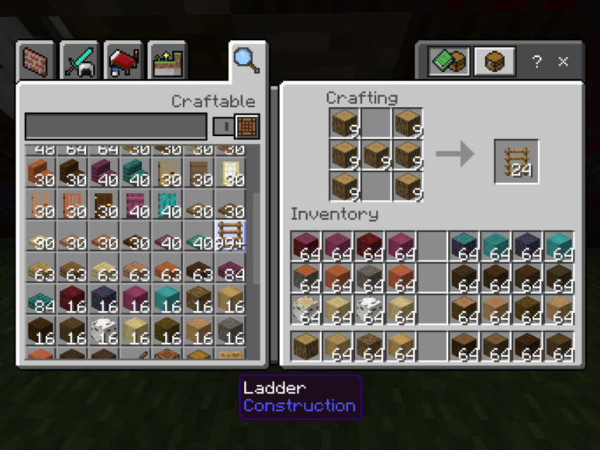

## Description

Bulk crafting a couple thousand fences or a whole load of chests is always a tedious task, especially on mobile. This addon is here to solve this issue!

Directly craft using raw materials such as logs/wood (and their stripped versions) into ladders, hoes and composters, or iron/copper blocks into bars and trapdoors (with respective oxidisation and waxing). The recipes are chosen to mirror vanilla crafting patterns as close as possible, with the number of items you craft is according to the original ratio of planks & sticks to resulting items. Therefore, some recipes have been tweaked slightly for the least wasteage. Explore!

Note: A few recipes return extra materials that are "leftovers" from crafting, especially for bamboo. These are returned in the highest resource form (usually planks).

Note 2: Some recipes have the same input patterns to vanilla recipes (i.e. 1 log = 4 buttons and 4 copper blocks = 9 trapdoors). The custom recipes have lower priority than vanilla recipes so these unambiguous recipes can only be accessed from the recipe book.

Note 3: Non-stackable items can't stack! Who knew? So the output shows only 1 of that item, but rest assured, you will get the right amount.

Note 4: For items that have no specific wood type matched to them, different woods can be mixed (thanks to the flattening!) except for bamboo due to its different log-to-plank ratio

## New Recipes

Here's the full list of items that can be crafted from raw materials:

See More

Wood:

- Boat
- Button
- Door
- Fence
- Fence Gate
- Pressure Plate
- Sign
- Slab
- Stair
- Trapdoor
- Barrel
- Beehive
- Bowl
- Chest
- Chiseled Bookshelf
- Composter
- Crafting Table
- Ladder
- Loom
- StickWooden Weapons (Axe, Hoe, Pickaxe, Shovel, Spear, Sword)

Iron:

- Bucket
- Cauldron
- Heavy Weighted Pressure Plate
- Iron Bars
- Iron Chain
- Iron Door
- Iron Trapdoor
- Minecart
- Shears
- Iron Armour (Helmet, Chestplate, Leggings, Boots)

Copper:

- Copper Bars
- Copper Chain
- Copper Door
- Copper Trapdoor
- Copper Armour (Helmet, Chestplate, Leggings, Boots) (waxing and oxidations are lost, must be crafted with the exace same waxing and oxidation)

 

Future Versions Note:

See More

P.S. As the flattening is not over yet, there might be minor changes to the pack (maybe even simplifications, so don't worry if a new version is smaller in size)

